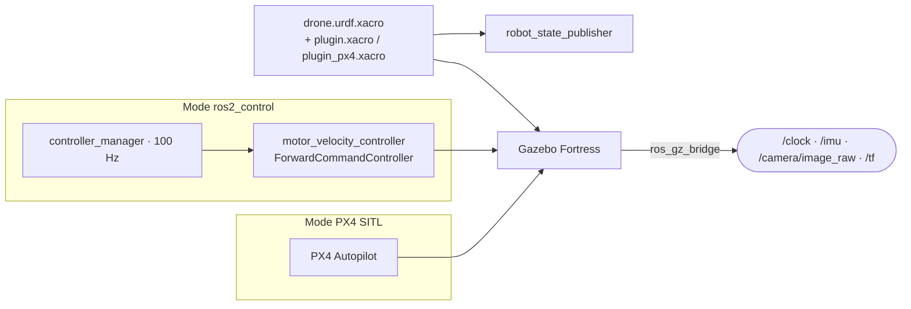

<div align="center">


<p>
  
  
  
  
  
</p>

<p><b><a href="https://lacinasidibe114-sudo.github.io/lacina-portfolio/">Portfolio</a> · <a href="https://github.com/lacinasidibe114-sudo">Tous mes projets</a></b></p>

</div>

## En bref

Modélisation et simulation d'un **quadrirotor de type DJI Air 3S** sous ROS 2 et Gazebo, avec deux modes de commande :

- **`ros2_control`** : les quatre hélices sont des articulations pilotées en vitesse par un `ForwardCommandController`, pour expérimenter la commande bas niveau.
- **PX4 (SITL)** : l'autopilote PX4 prend en charge la stabilisation et l'odométrie, ROS 2 reçoit les capteurs par `ros_gz_bridge`.

> **Statut : en cours.** Le modèle, les capteurs et les deux modes de lancement sont en place ; l'intégration complète de PX4 (commande de mission depuis ROS 2) est la prochaine étape.

## Modèle

| Élément | Détail |
|---|---|
| Fuselage | 0,40 kg, inerties renseignées, coque, bras et carénages en primitives |
| Propulsion | 4 hélices `prop_fl/fr/rl/rr_joint` pilotées en vitesse |
| Capteurs | Caméra sur nacelle (`/camera/image_raw`, `/camera/camera_info`) et IMU (`/imu`) |
| Simulateur | Gazebo Fortress (`ignition-gazebo` 6) via `ros_gz_sim` |

## Architecture



## Démarrage rapide

```bash
git clone https://github.com/lacinasidibe114-sudo/Drone.git ~/drone_ws
cd ~/drone_ws
rosdep install --from-paths src -y --ignore-src
colcon build && source install/setup.bash

# Mode ros2_control : commande directe des hélices
ros2 launch robot_description gazebo.launch.py
ros2 topic pub /motor_velocity_controller/commands std_msgs/msg/Float64MultiArray "{data: [400.0, 400.0, 400.0, 400.0]}"

# Mode PX4 : capteurs exposés à ROS 2, PX4 gère le vol
ros2 launch robot_description gazebo_px4.launch.py
```

## Feuille de route

- [x] Modèle URDF/Xacro avec inerties, caméra et IMU
- [x] Simulation Gazebo et contrôleur de vitesse des hélices
- [x] Pont ROS 2 ↔ Gazebo pour les capteurs
- [ ] Liaison PX4 ↔ ROS 2 (uXRCE-DDS) et envoi de consignes de position
- [ ] Mission autonome : décollage, suivi de points de passage, atterrissage

---

<div align="center">


<sub><b>Lacina Sidibé</b> · Élève-ingénieur Robotique &amp; IA · <a href="https://lacinasidibe114-sudo.github.io/lacina-portfolio/">Portfolio</a> · en recherche de PFE 2027</sub>

</div>
